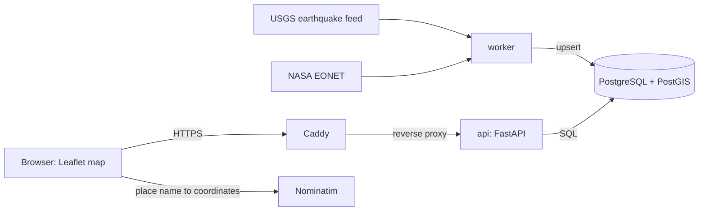

# Meridian

A live natural-hazard map and REST API. Meridian pulls earthquakes from USGS and wildfires, storms and sea ice from NASA EONET, stores them in PostgreSQL + PostGIS, and lets you search any place on Earth for what's happening near it.

**Live:** [meridian.allankangethe.com](https://meridian.allankangethe.com) · **API docs:** [/docs](https://meridian.allankangethe.com/docs)

## What it does

- **Ingests two live sources.** A background worker polls the USGS earthquake feed and NASA EONET every 5 minutes. Each record is validated with Pydantic, and bad records are logged and skipped instead of crashing the run.
- **Never stores the same event twice.** Every insert is an upsert on a unique `(source, source_event_id)` key, so overlapping fetches update existing rows instead of duplicating them.
- **Searches by place.** Type a city or country, and the map flies there and lists every event within 500 km, using a PostGIS radius query backed by a GiST spatial index.
- **Filters by type.** Chips for earthquakes, wildfires, storms and more, which combine with the place search.
- **Watch zones.** Click the map to drop a zone with a radius and minimum magnitude. Zones are validated, stored and drawn on the map.

## Architecture



Four containers, defined in [compose.yaml](compose.yaml):

| Service | Job |
|---|---|
| `api` | FastAPI app. Serves the REST API and the static front end. |
| `worker` | Polls USGS and EONET every 5 minutes and upserts events. Same image as `api`, different command. |
| `db` | PostgreSQL 17 with PostGIS 3.5. Data lives in a named volume, so it survives `docker compose down`. |
| `caddy` | Reverse proxy with automatic Let's Encrypt HTTPS. Production only (`--profile prod`). |

The database has no published port. Only `api` and `worker` can reach it, over the internal Docker network.

## Run it locally

Requires Docker Desktop (or Docker Engine with Compose).

```bash
git clone https://github.com/AllanKangethe/meridian.git
cd meridian
cp .env.example .env          # then set POSTGRES_USER, POSTGRES_PASSWORD, POSTGRES_DB
docker compose up -d --build
docker compose exec api alembic upgrade head
```

Open [http://localhost:8000](http://localhost:8000). The worker fills the database within a few seconds of starting.

Useful commands:

```bash
docker compose logs -f worker                               # watch ingestion
docker compose exec db sh -c 'psql -U "$POSTGRES_USER" -d "$POSTGRES_DB"'   # open psql
docker compose --profile prod up -d                          # production, with Caddy
```

## API

Interactive docs are at `/docs`.

| Method | Path | Purpose |
|---|---|---|
| GET | `/health` | Service status, including whether the database is reachable (503 if not) |
| GET | `/events` | List events, newest first |
| POST | `/watch-zones` | Create a watch zone (201, or 422 for invalid input) |
| GET | `/watch-zones` | List watch zones |
| DELETE | `/watch-zones/{id}` | Delete a watch zone (204, or 404 if it doesn't exist) |

`/events` query parameters:

| Parameter | Meaning |
|---|---|
| `type` | Event type, e.g. `earthquake`, `wildfire`, `severe storm` |
| `min_mag` | Minimum earthquake magnitude (applies to USGS events only) |
| `since` | Only events on or after this ISO timestamp |
| `lat`, `lon`, `radius_km` | Events within `radius_km` of a point (default 500, max 5000) |
| `limit`, `offset` | Pagination (limit 1 to 500, default 100) |

Example: wildfires within 500 km of Los Angeles.

```bash
curl "https://meridian.allankangethe.com/events?type=wildfire&lat=34.05&lon=-118.24&radius_km=500"
```

## Design decisions

- **Upsert on a unique key.** Feeds overlap from one poll to the next. The unique constraint on `(source, source_event_id)` with `ON CONFLICT ... DO UPDATE` makes ingestion idempotent: running it twice leaves the same rows, and corrected magnitudes from the source still get applied.
- **`geography`, not `geometry`.** Distances on a `geography` column are in meters on the curved Earth, so a 500 km radius means 500 km anywhere, including near the poles. A GiST index keeps `ST_DWithin` fast.
- **Alembic migrations instead of `create_all`.** Every schema change is a versioned file that can be applied, rolled back and replayed on the server, so local and production databases stay identical.
- **Validation at the edge.** Pydantic models define what a valid record is. The worker just tries to build the model and skips anything that fails, so a malformed record from a source never takes down the whole run.
- **Capped result sizes.** `limit` maxes out at 500. An unbounded list would let one request pull the entire table.
- **Nothing exposed that doesn't need to be.** Only ports 80 and 443 are public. The API listens on `127.0.0.1`, the database has no published port, and the image runs as a non-root user.
- **Multi-stage Dockerfile.** Dependencies are installed in a builder stage and copied into a clean slim image, which keeps build tools out of the final image.

## What broke and what I changed

- **The API was public on port 8000.** `ports: "8000:8000"` published it on every interface, bypassing Caddy and HTTPS, and Docker's published ports skip the ufw firewall. Changed to `127.0.0.1:8000:8000`, since Caddy reaches the API over the Docker network anyway.
- **The site went down after a restart.** Running `docker compose down` then `up` on the server without `--profile prod` left Caddy stopped. Production commands now always include the profile.
- **Renaming the volume wiped the database.** Compose treats a renamed volume as a brand new, empty one. Recovered by re-running `alembic upgrade head` and letting the worker refill the data. Lesson: a volume name is part of your data's address.
- **EONET's JSON didn't match my first model.** `categories` and `geometry` are lists, not objects, and the magnitude key is `magnitudeValue`. Calling `.get()` on a list raised an `AttributeError`, which the worker didn't catch, so the whole EONET run failed. Fixed by taking the first category and the latest geometry, with safe defaults.
- **Wildfires used the earthquake upsert.** That query hardcoded `source = 'usgs'`, so fires would have been stored as USGS events. Added a separate EONET upsert.
- **A 519-acre fire covered the whole map.** Marker size was `3 + magnitude * 1.5`, which only makes sense on the Richter scale. Severity is now calculated per unit (Richter, acres, knots, square nautical miles), and non-earthquake markers use fixed sizes.
- **Event types didn't match the filters.** EONET sends `Wildfires`, but the filter asked for `wildfire`, and SQL comparisons are case-sensitive. Types are now lowercased and mapped to one spelling when they're ingested.
- **One event without a unit broke the whole list.** Calling `.charAt()` on a null `magnitude_unit` threw an error and stopped rendering. The front end now checks for missing values.
- **Changes didn't show up on the live site.** Browsers cached the old CSS and JavaScript, so a deploy looked like it hadn't worked until a hard refresh. Versioned asset URLs (`app.js?v=3`) make browsers fetch the new file.

## Roadmap

- Alert delivery: POST each new event to the webhook of every watch zone it falls inside, with retries
- Tests (pytest) and CI with GitHub Actions
- Cross-source duplicate detection

## Data sources

- Earthquakes: [USGS Earthquake Hazards Program](https://earthquake.usgs.gov/earthquakes/feed/)
- Wildfires, storms and sea ice: [NASA EONET](https://eonet.gsfc.nasa.gov/)
- Map tiles: © [OpenStreetMap](https://www.openstreetmap.org/copyright) contributors
- Place search: [Nominatim](https://nominatim.org/)
